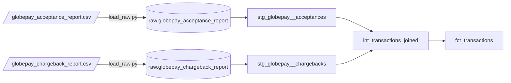

# Part 1 — Ingestion and modeling

## 1. Preliminary data exploration

Two Globepay reports were provided as CSVs with no schema, plus the Globepay API specification. Both CSVs are
loaded untouched (every column as text) into `DEEL_AE.RAW` by [scripts/load_raw.py](../scripts/load_raw.py), and
explored there. The queries are versioned as dbt analyses in [analyses/exploration](../analyses/exploration) and can
be run with `dbt show -s <analysis_name>`.

### Acceptance report — `globepay_acceptance_report`

One row per payment attempt sent to Globepay.

| Column | Raw example | Notes |
|---|---|---|
| `external_ref` | `nCyEIIGaP5QQ2Wqb-_Rt8` | Unique, never null, 21 chars. Key to the chargeback report. |
| `status` | `TRUE` | Same value on every row. |
| `source` | `GLOBALPAY` | Same value on every row. |
| `ref` | `evt_1ESgcCOV7fY1ChY1MkZizZt` | Unique, never null. Globepay event id. |
| `date_time` | `2019-01-01T00:00:00.000Z` | ISO-8601 UTC. |
| `state` | `ACCEPTED` / `DECLINED` | |
| `cvv_provided` | `TRUE` / `FALSE` | |
| `amount` | `1020.46` | Decimal, in the transaction currency. |
| `country` | `US` | Two-letter card country. |
| `currency` | `USD` | Three-letter ISO currency. |
| `rates` | `{"CAD":1.415,"EUR":0.926,...}` | JSON of FX rates, units of currency per 1 USD. |

Profile:

- **5,430 rows**, 5,430 distinct `external_ref` and `ref`, no missing ids.
- **2019-01-01 to 2019-06-30**, 181 days. Exactly 30 transactions a day, at five fixed times
  (00:00, 04:48, 09:36, 14:24, 19:12), one per country at each time. The data is clearly synthetic.
- **3,777 accepted (69.6%)** and **1,653 declined**. Monthly acceptance stays between 67.8% and 71.7%.
- **905 transactions per country**, six countries, one currency each:

  | Country | Currency | Transactions | Accepted |
  |---|---|---|---|
  | AE | USD | 905 | 614 |
  | CA | CAD | 905 | 630 |
  | FR | EUR | 905 | 634 |
  | MX | MXN | 905 | 644 |
  | UK | GBP | 905 | 647 |
  | US | USD | 905 | 608 |

- **Amounts** range from -23.78 to 180,371.52, median 85,488. One accepted transaction has a negative amount.
- **CVV** was provided on only 40 transactions (0.7%).
- **Rates**: every row carries the same seven currencies (AUD, CAD, EUR, GBP, MXN, SGD, USD); AUD and SGD are never
  used as a transaction currency. There are 1,086 distinct rate sets, and transactions sharing the exact same
  timestamp carry different rates, so rates are per transaction rather than a market snapshot. EUR moves 38.5% and
  GBP 33% between their min and max over six months, far more than the real market did in H1 2019.

### Chargeback report — `globepay_chargeback_report`

| Column | Raw example | Notes |
|---|---|---|
| `external_ref` | `_-UTDS0dMlagMWEtQKMy-` | Unique, never null. |
| `status` | `TRUE` | Same value on every row. |
| `source` | `GLOBALPAY` | Same value on every row. |
| `chargeback` | `TRUE` / `FALSE` | |

- **5,430 rows**, one per transaction. The join on `external_ref` is complete in both directions: no acceptance
  without a chargeback record and no orphan chargeback.
- **223 chargebacks**, all on accepted transactions (5.9% of accepted). Declined transactions always have
  `chargeback = FALSE`, which in practice means "not applicable".

### Differences from the API specification

- The spec says amounts are in minor units; the report holds decimal major units (`1020.46`).
- The spec describes `external_ref` as "the card expiry year", an obvious copy-paste error. Its example also uses an
  `evt_...` value as `external_ref`; in the report that format lives in `ref`.
- `merchantReference` (Deel's order number) is in the spec but not in the report, so transactions can't be tied back
  to a Deel client or invoice yet.
- The spec says the country is ISO-2, but the United Kingdom comes as `UK` instead of `GB`.

### Decisions taken from the exploration

| Finding | Decision |
|---|---|
| `status` and `source` are constant | Dropped in staging. Source tests fail if a different value ever shows up. |
| Rates are per transaction and only one rate applies | Keep the rate of the transaction's own currency as `fx_rate_to_usd` and compute `amount_usd = amount / rate`. The full JSON stays in staging as `fx_rates` for traceability. |
| Negative amount | Kept. A test warns on it rather than failing the build, until it's confirmed whether it's a refund or a reversal. |
| `UK` country code | Kept as received and documented, so the data still matches Globepay. |
| Chargeback data is complete today | The model still flags missing chargeback records (`has_chargeback_data`), so future gaps show up. |

## 2. Model architecture

The project follows dbt's [recommended structure](https://docs.getdbt.com/best-practices/how-we-structure/1-guide-overview):

| Layer | Model | Materialization | Grain | Purpose |
|---|---|---|---|---|
| raw | `RAW.GLOBEPAY_ACCEPTANCE_REPORT`, `RAW.GLOBEPAY_CHARGEBACK_REPORT` | table (loader) | as received | Untouched copy of the files, all text, plus `_source_file` and `_loaded_at`. Declared as dbt sources. |
| staging | `stg_globepay__acceptances` | view | transaction | Rename, cast types, parse `rates`, convert to USD. |
| staging | `stg_globepay__chargebacks` | view | transaction | Rename and cast the chargeback flag. |
| intermediate | `int_transactions_joined` | view | transaction | Left join of acceptances to chargebacks, `has_chargeback_data` flag. |
| marts | `fct_transactions` | table | transaction | Analyst-facing fact table used for Part 2. |

`fct_transactions` columns: `transaction_id`, `globepay_event_id`, `transaction_state`, `country_code`,
`currency_code`, `amount_local`, `fx_rate_to_usd`, `amount_usd`, `is_accepted`, `is_cvv_provided`, `is_chargeback`
(null when chargeback data is missing), `has_chargeback_data`, `transacted_date`, `transacted_at` (UTC).

Some choices worth calling out:

- **Ingestion outside dbt.** dbt seeds are meant for small static reference data, not provider reports, so a Python
  script plays the role of the EL tool and dbt only reads the result as sources. Loading everything as text means
  a bad value never breaks the load; types are enforced in staging, where tests can catch problems.
- **FX conversion in staging.** It only uses columns from the same row, which dbt's guide treats as normal staging
  work, like converting cents to dollars.
- **Intermediate as a view, not ephemeral**, so it can be tested and queried while debugging.
- **One fact table, no dimensions yet.** With six countries and five currencies a `dim_country` would add a join and
  nothing else. It becomes worth it once country names, regions or Deel client data come into play.
- **Descriptions persisted to Snowflake** (`persist_docs`), so analysts see the column definitions in Snowsight.

Schemas in dev are `DBT_DEV_STAGING`, `DBT_DEV_INTERMEDIATE` and `DBT_DEV_MARTS`.

## 3. Lineage



The interactive version, with column-level docs and tests, comes from dbt itself:

```bash
dbt docs generate
dbt docs serve
```

## 4. Tips on macros, data validation and documentation

### Macros

- **Check packages before writing a macro.** `dbt_utils` is already installed and used for `expression_is_true`;
  `dbt_expectations` covers distribution and row-count checks; `codegen` generates source YAML, base staging models
  and model YAML from the warehouse, which removes most of the typing when a new source arrives.
- **Override `generate_schema_name`** before going to production, so prod builds into clean `staging` / `marts`
  schemas while each developer keeps a personal prefix in dev.
- **Turn logic into a macro once it repeats, not before.** The USD conversion is used once and reads better inline.
  If a second payment provider is added, a `to_usd(amount, rate)` macro keeps both staging models consistent.
- **Custom generic tests are macros too.** An `is_valid_iso_country` test would catch the `UK` vs `GB` issue at the
  source instead of in a description.

### Data validation

Tests are layered so a problem is caught as close to its origin as possible:

| Layer | Tests in this project |
|---|---|
| sources | `unique` / `not_null` on `external_ref`; `accepted_values` on the constant `status` and `source` columns |
| staging | `unique` / `not_null` on ids; `accepted_values` on state and currency; `relationships` from chargebacks to acceptances; `fx_rate_to_usd > 0`; `amount_local >= 0` (warn) |
| staging (unit test) | `amount_usd` is computed with the transaction's own currency rate, for USD, MXN and EUR |
| intermediate | `unique` / `not_null` on `transaction_id`, which catches join fan-out |
| marts | `unique` / `not_null`; only accepted transactions can be charged back; missing chargeback data (warn) |

`dbt build` currently runs 38 checks: 37 pass, and the negative-amount test warns as intended.

Next steps for production:

- **Freshness:** add `warn_after` / `error_after` to the source once the loader runs on a schedule; `_loaded_at` is
  already configured as the `loaded_at_field`.
- **Severity:** use `warn` for "needs a look" rules and `error` for "the numbers are wrong" rules, and
  `store_failures: true` to keep failing rows in a table for investigation.
- **Model contracts** on `fct_transactions`, so a column type or name change fails the build instead of breaking
  the analyst's queries.
- **Volume and range checks** with `dbt_expectations`, e.g. daily row counts or FX rates within a band, which would
  have flagged the unrealistic EUR and GBP swings.
- **Slim CI:** `dbt build --select state:modified+` on every pull request.

### Documentation

- Every model and every column of the staging and mart models has a description in YAML, next to the SQL.
- `persist_docs` writes those descriptions to Snowflake as table and column comments.
- `dbt docs generate` / `dbt docs serve` gives the searchable catalog and lineage graph.
- As the project grows: `` blocks for definitions repeated across layers (like `transaction_id`), `meta`
  fields for owner and PII flags, and `exposures` for the dashboards built on `fct_transactions`, so lineage
  reaches the end consumer.
