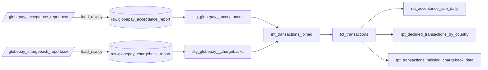

# Part 1: Ingestion and modeling

## 1. Preliminary data exploration

I got two Globepay reports as CSVs, with no schema, plus the Globepay API spec. I loaded both files into
`DEEL_AE.RAW` exactly as they came, every column as text, with [scripts/load_raw.py](../scripts/load_raw.py), and
explored them there. The queries are in [analyses/exploration](../analyses/exploration) and can be rerun with
`dbt show -s <analysis_name>`.

### Acceptance report (`globepay_acceptance_report`)

One row per payment attempt sent to Globepay.

| Column | Example | Notes |
|---|---|---|
| `external_ref` | `nCyEIIGaP5QQ2Wqb-_Rt8` | Unique, never null. Joins to the chargeback report. |
| `status` | `TRUE` | Same value on every row. |
| `source` | `GLOBALPAY` | Same value on every row. |
| `ref` | `evt_1ESgcCOV7fY1ChY1MkZizZt` | Unique, never null. Globepay event id. |
| `date_time` | `2019-01-01T00:00:00.000Z` | ISO-8601, UTC. |
| `state` | `ACCEPTED` / `DECLINED` | |
| `cvv_provided` | `TRUE` / `FALSE` | |
| `amount` | `1020.46` | Decimal, in the transaction currency. |
| `country` | `US` | Card country. |
| `currency` | `USD` | |
| `rates` | `{"CAD":1.415,"EUR":0.926,...}` | JSON, units of each currency per 1 USD. |

What I found:

- 5,430 rows, with 5,430 distinct `external_ref` and `ref` values and no missing ids.
- Data from 2019-01-01 to 2019-06-30 (181 days). There are exactly 30 transactions a day at five fixed times
  (00:00, 04:48, 09:36, 14:24, 19:12), one per country each time, so the data is synthetic.
- 3,777 accepted (69.6%) and 1,653 declined. Monthly acceptance stays between 67.8% and 71.7%.
- Six countries with 905 transactions each, and one currency per country:

  | Country | Currency | Transactions | Accepted |
  |---|---|---|---|
  | AE | USD | 905 | 614 |
  | CA | CAD | 905 | 630 |
  | FR | EUR | 905 | 634 |
  | MX | MXN | 905 | 644 |
  | UK | GBP | 905 | 647 |
  | US | USD | 905 | 608 |

- Amounts go from -23.78 to 180,371.52, median 85,488. One accepted transaction is negative.
- CVV was sent on only 40 transactions (0.7%).
- Every `rates` object has the same seven currencies (AUD, CAD, EUR, GBP, MXN, SGD, USD). AUD and SGD are never a
  transaction currency. There are 1,086 distinct rate sets, and transactions with the exact same timestamp have
  different rates, so the rate is set per transaction, not a market snapshot. EUR moves 38.5% and GBP 33% between
  min and max over six months, much more than the real market did in H1 2019.

### Chargeback report (`globepay_chargeback_report`)

| Column | Example | Notes |
|---|---|---|
| `external_ref` | `_-UTDS0dMlagMWEtQKMy-` | Unique, never null. |
| `status` | `TRUE` | Same value on every row. |
| `source` | `GLOBALPAY` | Same value on every row. |
| `chargeback` | `TRUE` / `FALSE` | |

- 5,430 rows, one per transaction. The join on `external_ref` matches every row on both sides.
- 223 chargebacks, all on accepted transactions (5.9% of accepted). Declined transactions are always
  `chargeback = FALSE`, which really means "not applicable".

### Where the data doesn't match the API spec

- The spec says amounts are in minor units, but the report has decimals in major units (`1020.46`).
- The spec describes `external_ref` as "the card expiry year", which is a copy-paste error. Its example also shows an
  `evt_...` value as `external_ref`, while in the report that format is in `ref`.
- `merchantReference` (Deel's order number) is in the spec but not in the report, so a transaction can't be linked
  to a Deel client or invoice yet.
- The spec says ISO-2 country codes, but the United Kingdom comes as `UK` instead of `GB`.

### What I decided based on this

| Finding | Decision |
|---|---|
| `status` and `source` never change | Dropped in staging. Tests on the source fail if another value shows up. |
| Only one rate per row is relevant | Keep the rate of the transaction's currency as `fx_rate_to_usd`, and `amount_usd = amount / rate`. The full JSON stays in staging as `fx_rates`. |
| One negative amount | Kept. A test warns on it until we know whether it's a refund or a reversal. |
| `UK` instead of `GB` | Kept as Globepay sends it, and documented. |
| Chargeback data is complete today | The model still flags transactions without a chargeback record (`has_chargeback_data`). |

## 2. Model architecture

I followed dbt's [project structure guide](https://docs.getdbt.com/best-practices/how-we-structure/1-guide-overview):

| Layer | Model | Materialization | Grain | What it does |
|---|---|---|---|---|
| raw | `RAW.GLOBEPAY_ACCEPTANCE_REPORT`, `RAW.GLOBEPAY_CHARGEBACK_REPORT` | table (loader) | as received | The files as text, plus `_source_file` and `_loaded_at`. Declared as dbt sources. |
| staging | `stg_globepay__acceptances` | view | transaction | Renames, casts, parses `rates`, converts to USD. |
| staging | `stg_globepay__chargebacks` | view | transaction | Renames and casts the chargeback flag. |
| intermediate | `int_transactions_joined` | view | transaction | Left join of acceptances to chargebacks, adds `has_chargeback_data`. |
| marts | `fct_transactions` | table | transaction | The table the analyst uses (Part 2). |
| reporting | `rpt_acceptance_rate_daily`, `rpt_declined_transactions_by_country`, `rpt_transactions_missing_chargeback_data` | table | day / country / transaction | One model per Part 2 question, built on `fct_transactions`. |

`fct_transactions` has `transaction_id`, `globepay_event_id`, `transaction_state`, `country_code`, `currency_code`,
`amount_local`, `fx_rate_to_usd`, `amount_usd`, `is_accepted`, `is_cvv_provided`, `is_chargeback` (null when there's
no chargeback record), `has_chargeback_data`, `transacted_date` and `transacted_at` (UTC).

Some of the choices:

- Ingestion is outside dbt. Seeds are meant for small static lookup data, not provider reports, so a Python script
  does the job an EL tool would and dbt reads the result as sources. Everything lands as text so a bad value never
  breaks the load. Types are applied in staging, where tests can catch problems.
- The USD conversion is in staging because it only uses columns from the same row, the same as converting cents to
  dollars.
- The intermediate model is a view rather than ephemeral, so it can be tested and queried when debugging.
- The reporting layer isn't one of dbt's standard layers. I added it so the Part 2 answers are models that get
  built and tested on every run, instead of saved queries that could break without anyone noticing. Marts stay
  generic; reporting models are shaped for a specific question.
- There are no dimension tables yet. With six countries a `dim_country` would only add a join. It makes sense once
  country names, regions or Deel client data are added.
- Descriptions are persisted to Snowflake (`persist_docs`), so they show up as comments in Snowsight.

In dev, models build into `DBT_DEV_STAGING`, `DBT_DEV_INTERMEDIATE`, `DBT_DEV_MARTS` and `DBT_DEV_REPORTING`. With
`--target prod` they build into `STAGING`, `INTERMEDIATE`, `MARTS` and `REPORTING` (see
[generate_schema_name](../macros/generate_schema_name.sql)).

## 3. Lineage



For the interactive graph with column docs and tests:

```bash
dbt docs generate
dbt docs serve
```

## 4. Tips on macros, data validation and documentation

### Macros

- Look for a package before writing a macro. `dbt_utils` is already used here for `expression_is_true`.
  `dbt_expectations` has distribution and row-count tests, and `codegen` generates source YAML, staging models and
  model YAML from the warehouse, which saves most of the typing when a new source comes in.
- Override `generate_schema_name` so prod builds into clean schemas and dev keeps a personal prefix. This project
  does that already.
- Only turn logic into a macro once it repeats. The USD conversion is used once and is easier to read inline. With a
  second payment provider, a `to_usd(amount, rate)` macro would keep both staging models consistent.
- Custom generic tests are macros too. An `is_valid_iso_country` test would catch `UK` vs `GB` at the source.

### Data validation

Tests sit at each layer, so a problem gets caught close to where it starts:

| Layer | Tests |
|---|---|
| sources | `unique` / `not_null` on `external_ref`; `accepted_values` on `status` and `source` |
| staging | `unique` / `not_null` on ids; `accepted_values` on state and currency; `relationships` from chargebacks to acceptances; `fx_rate_to_usd > 0`; `amount_local >= 0` (warn) |
| staging, unit test | `amount_usd` uses the rate of the transaction's own currency (USD, MXN and EUR cases) |
| intermediate | `unique` / `not_null` on `transaction_id`, which catches a join that duplicates rows |
| marts | `unique` / `not_null`; only accepted transactions can be charged back; missing chargeback data (warn); an enforced model contract |
| reporting | `unique` / `not_null` on each model's grain; acceptance rate between 0 and 1; a singular test that reporting totals match `fct_transactions` |

For production I would also add:

- Source freshness with `warn_after` / `error_after` once the load runs on a schedule. `_loaded_at` is already set
  as the `loaded_at_field`.
- `warn` for rules that need a look and `error` for rules that mean the numbers are wrong, plus
  `store_failures: true` to keep the failing rows in a table.
- Volume and range checks with `dbt_expectations`, like daily row counts or FX rates within a band. That would have
  caught the EUR and GBP swings.
- Slim CI running `dbt build --select state:modified+` on each pull request.

### Documentation

- Every model, and every column in staging, marts and reporting, has a description in YAML next to the SQL.
- `persist_docs` writes them to Snowflake as table and column comments.
- `dbt docs generate` / `dbt docs serve` gives a searchable catalog and the lineage graph.
- As the project grows, `` blocks avoid repeating the same definition across layers (`transaction_id` is
  described three times now), `meta` can hold owner and PII flags, and `exposures` extend lineage to the dashboards
  built on `fct_transactions`.
