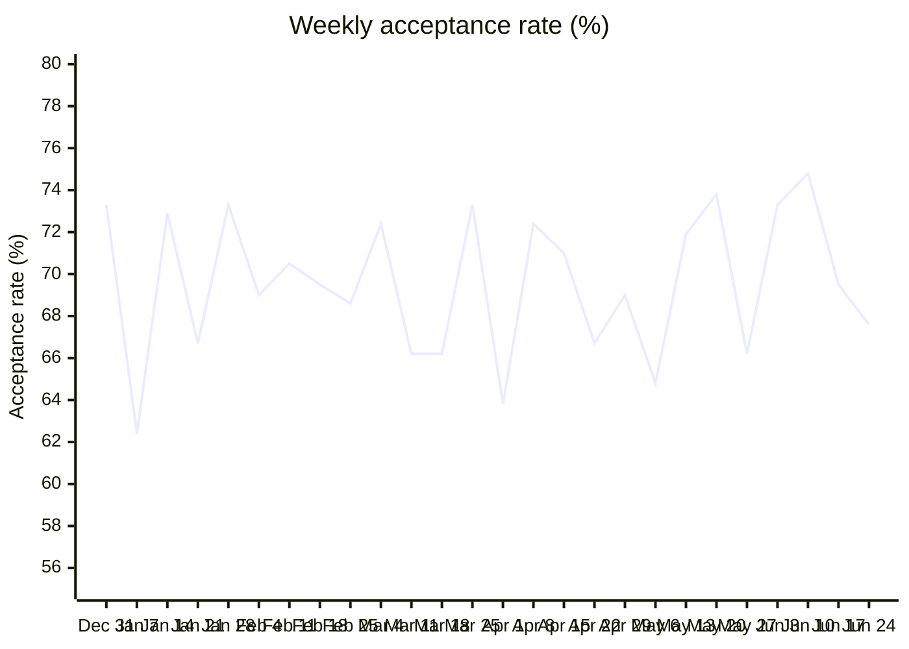

# Part 2: Production model and answers

## The model

Use `fct_transactions` (schema `MARTS` in prod, `DBT_DEV_MARTS` in dev). It has one row per payment attempt Deel
sent to Globepay, so any count or sum over it is a count or sum of transactions.

| Column | Use it for |
|---|---|
| `transacted_date`, `transacted_at` | Time, in UTC |
| `is_accepted`, `transaction_state` | Outcome of the payment |
| `country_code`, `currency_code` | Card country and transaction currency |
| `amount_local` | Amount in the transaction currency |
| `amount_usd` | Amount in USD, converted with the rate Globepay sent for that transaction. Use this for anything summed across countries. |
| `is_chargeback` | Charged back or not. Null when Globepay sent no chargeback record. |
| `has_chargeback_data` | False when the chargeback record is missing |

What makes it production ready:

- It's a table rebuilt on every run from tested staging and intermediate models, with 34 data and unit tests
  running in the same `dbt build`.
- It has an enforced contract: if a change upstream renames a column or changes a type, the build fails instead of
  silently breaking queries on top of it.
- `dbt build --target prod` builds it into clean `STAGING` / `INTERMEDIATE` / `MARTS` schemas, separate from dev.
- Column descriptions are visible in Snowsight as comments.

The queries below are in [analyses/part_2](../analyses/part_2). `dbt compile` turns them into plain SQL in
`target/compiled/`, or `dbt show -s <name>` runs them directly.

## 1. What is the acceptance rate over time?

Acceptance rate is accepted transactions over all transactions. I also added the rate weighted by USD amount, in
case the analyst cares about volume rather than count.

```sql


select
    date_trunc({{ grain }}, transacted_date) as period_start,
    count(*) as transactions,
    count_if(is_accepted) as accepted_transactions,
    round(accepted_transactions / transactions, 4) as acceptance_rate,
    round(sum(iff(is_accepted, amount_usd, 0)) / sum(amount_usd), 4) as acceptance_rate_by_amount
from {{ ref('fct_transactions') }}
group by period_start
order by period_start
```

`dbt show -s acceptance_rate_over_time` gives it by month, and `--vars '{grain: week}'` (or `day`) changes the grain.

| Month | Transactions | Accepted | Acceptance rate | By USD amount |
|---|---|---|---|---|
| 2019-01 | 930 | 647 | 69.6% | 68.9% |
| 2019-02 | 840 | 589 | 70.1% | 70.6% |
| 2019-03 | 930 | 641 | 68.9% | 69.1% |
| 2019-04 | 900 | 610 | 67.8% | 68.5% |
| 2019-05 | 930 | 645 | 69.4% | 68.8% |
| 2019-06 | 900 | 645 | 71.7% | 71.0% |

Weekly (weeks start on Monday, so the first week only has Jan 1 to 6):



**Answer:** acceptance is stable at about 70% (69.6% over the whole period, 69.6% by amount too). Monthly it goes
from 67.8% in April to 71.7% in June. Week to week it moves between 62% and 75%, which is mostly noise at around 210
transactions a week; there's no trend up or down.

## 2. Countries where declined transactions went over $25M

Declined amounts have to be summed in USD. Summing `amount_local` would add euros, pesos and dollars together.

```sql
select
    country_code,
    count(*) as declined_transactions,
    sum(amount_usd) as declined_amount_usd
from {{ ref('fct_transactions') }}
where not is_accepted
group by country_code
having declined_amount_usd > 25000000
order by declined_amount_usd desc
```

| Country | Declined transactions | Declined amount (USD) |
|---|---|---|
| FR | 271 | 32,628,785.95 |
| UK | 258 | 27,489,496.65 |
| AE | 291 | 26,335,152.43 |
| US | 297 | 25,125,669.78 |

**Answer:** France, the United Kingdom, the UAE and the United States. The US is only about $126K over the line,
so a small change in the data could move it. Canada ($18.4M) and Mexico ($0.9M) are below.

Converting matters here: in local currency France (24.6M EUR) and the UK (19.7M GBP) would drop out, and Canada
(25.6M CAD) would come in.

## 3. Which transactions are missing chargeback data?

```sql
select
    transaction_id,
    globepay_event_id,
    transacted_at,
    transaction_state,
    country_code,
    amount_usd
from {{ ref('fct_transactions') }}
where not has_chargeback_data
order by transacted_at
```

**Answer:** none. All 5,430 transactions have a chargeback record. The query returns no rows today, and the
`has_chargeback_data` test in the model warns on the next build if that changes.

Two things to keep in mind:

- Declined transactions always have `is_chargeback = false`. A declined payment can't be charged back, so read that
  as "not applicable" rather than "no chargeback".
- The 223 chargebacks are all on accepted transactions, 5.9% of them.
