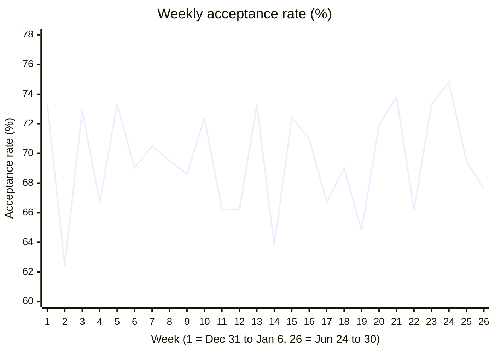

# Part 2: Production model and answers

## The models

`fct_transactions` (schema `MARTS` in prod, `DBT_DEV_MARTS` in dev) is the base table. It has one row per payment
attempt Deel sent to Globepay, so any count or sum over it is a count or sum of transactions.

| Column | Use it for |
|---|---|
| `transacted_date`, `transacted_at` | Time, in UTC |
| `is_accepted`, `transaction_state` | Outcome of the payment |
| `country_code`, `currency_code` | Card country and transaction currency |
| `amount_local` | Amount in the transaction currency |
| `amount_usd` | Amount in USD, converted with the rate Globepay sent for that transaction. Use this for anything summed across countries. |
| `is_chargeback` | Charged back or not. Null when Globepay sent no chargeback record. |
| `has_chargeback_data` | False when the chargeback record is missing |

On top of it, a reporting layer (schema `REPORTING` in prod, `DBT_DEV_REPORTING` in dev) has one model per
question, built and tested on every run like the rest of the project:

| Model | Grain | Question |
|---|---|---|
| [`rpt_acceptance_rate_daily`](../models/reporting/payments/rpt_acceptance_rate_daily.sql) | day | 1. Acceptance rate over time |
| [`rpt_declined_transactions_by_country`](../models/reporting/payments/rpt_declined_transactions_by_country.sql) | country | 2. Declined amount by country |
| [`rpt_transactions_missing_chargeback_data`](../models/reporting/payments/rpt_transactions_missing_chargeback_data.sql) | transaction | 3. Missing chargeback data |

What makes this production ready:

- Everything is rebuilt on each `dbt build`, with 43 data and unit tests running in the same command, including a
  test that the reporting totals match `fct_transactions`.
- `fct_transactions` has an enforced contract: if a change upstream renames a column or changes a type, the build
  fails instead of silently breaking queries on top of it.
- `dbt build --target prod` builds into clean `STAGING` / `INTERMEDIATE` / `MARTS` / `REPORTING` schemas,
  separate from dev.
- Column descriptions are visible in Snowsight as comments.

## 1. What is the acceptance rate over time?

Acceptance rate is accepted transactions over all transactions. The model also has the rate weighted by USD amount,
in case the analyst cares about volume rather than count.

```sql
select
    transacted_date,
    count(*) as transactions,
    count_if(is_accepted) as accepted_transactions,
    accepted_transactions / transactions as acceptance_rate,
    sum(amount_usd) as total_amount_usd,
    sum(iff(is_accepted, amount_usd, 0)) as accepted_amount_usd,
    accepted_amount_usd / nullif(total_amount_usd, 0) as acceptance_rate_by_amount
from {{ ref('fct_transactions') }}
group by transacted_date
```

The model is daily so it can be rolled up to any period. To get months, sum the counts and divide again (averaging
the daily rates would weight every day the same):

```sql
select
    date_trunc(month, transacted_date) as month,
    sum(transactions) as transactions,
    sum(accepted_transactions) as accepted_transactions,
    accepted_transactions / transactions as acceptance_rate,
    sum(accepted_amount_usd) / sum(total_amount_usd) as acceptance_rate_by_amount
from reporting.rpt_acceptance_rate_daily
group by month
order by month
```

| Month | Transactions | Accepted | Acceptance rate | By USD amount |
|---|---|---|---|---|
| 2019-01 | 930 | 647 | 69.6% | 68.9% |
| 2019-02 | 840 | 589 | 70.1% | 70.6% |
| 2019-03 | 930 | 641 | 68.9% | 69.1% |
| 2019-04 | 900 | 610 | 67.8% | 68.5% |
| 2019-05 | 930 | 645 | 69.4% | 68.8% |
| 2019-06 | 900 | 645 | 71.7% | 71.0% |

Weekly (weeks start on Monday, so week 1 only has Jan 1 to 6; week 14 starts Apr 1):



**Answer:** acceptance is stable at about 70% (69.6% over the whole period, 69.6% by amount too). Monthly it goes
from 67.8% in April to 71.7% in June. Week to week it moves between 62% and 75%, which is mostly noise at around 210
transactions a week; there's no trend up or down.

## 2. Countries where declined transactions went over $25M

Declined amounts have to be summed in USD. Summing `amount_local` would add euros, pesos and dollars together.

The model keeps every country, so the $25M threshold stays in the question rather than in the model:

```sql
select
    country_code,
    count(*) as transactions,
    count_if(not is_accepted) as declined_transactions,
    sum(iff(not is_accepted, amount_usd, 0)) as declined_amount_usd
from {{ ref('fct_transactions') }}
group by country_code
```

```sql
select
    country_code,
    declined_transactions,
    declined_amount_usd
from reporting.rpt_declined_transactions_by_country
where declined_amount_usd > 25000000
order by declined_amount_usd desc
```

| Country | Declined transactions | Declined amount (USD) |
|---|---|---|
| FR | 271 | 32,628,785.95 |
| UK | 258 | 27,489,496.65 |
| AE | 291 | 26,335,152.43 |
| US | 297 | 25,125,669.78 |

**Answer:** France, the United Kingdom, the UAE and the United States. The US is only about $126K over the line,
so a small change in the data could move it. Canada ($18.4M) and Mexico ($0.9M) are below.

Converting matters here: in local currency France (24.6M EUR) and the UK (19.7M GBP) would drop out, and Canada
(25.6M CAD) would come in.

## 3. Which transactions are missing chargeback data?

```sql
select
    transaction_id,
    globepay_event_id,
    transacted_at,
    transaction_state,
    country_code,
    amount_usd
from {{ ref('fct_transactions') }}
where not has_chargeback_data
```

The analyst can query `reporting.rpt_transactions_missing_chargeback_data` directly.

**Answer:** none. All 5,430 transactions have a chargeback record, so the model is empty today. The
`has_chargeback_data` test on `fct_transactions` warns on the next build if that changes.

Two things to keep in mind:

- Declined transactions always have `is_chargeback = false`. A declined payment can't be charged back, so read that
  as "not applicable" rather than "no chargeback".
- The 223 chargebacks are all on accepted transactions, 5.9% of them.
